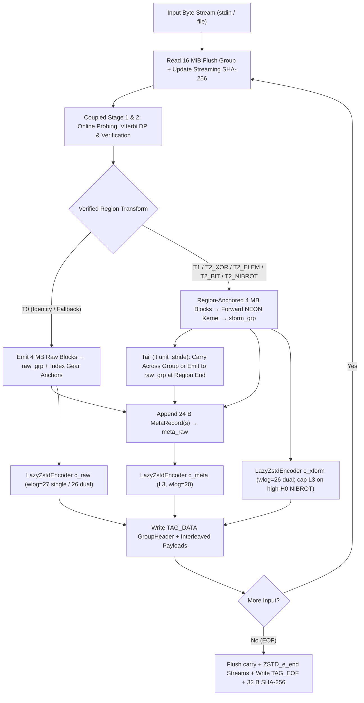
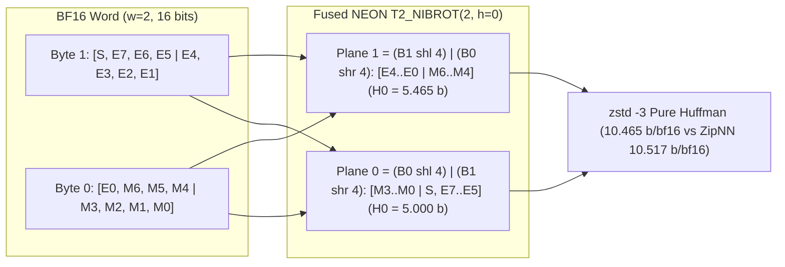
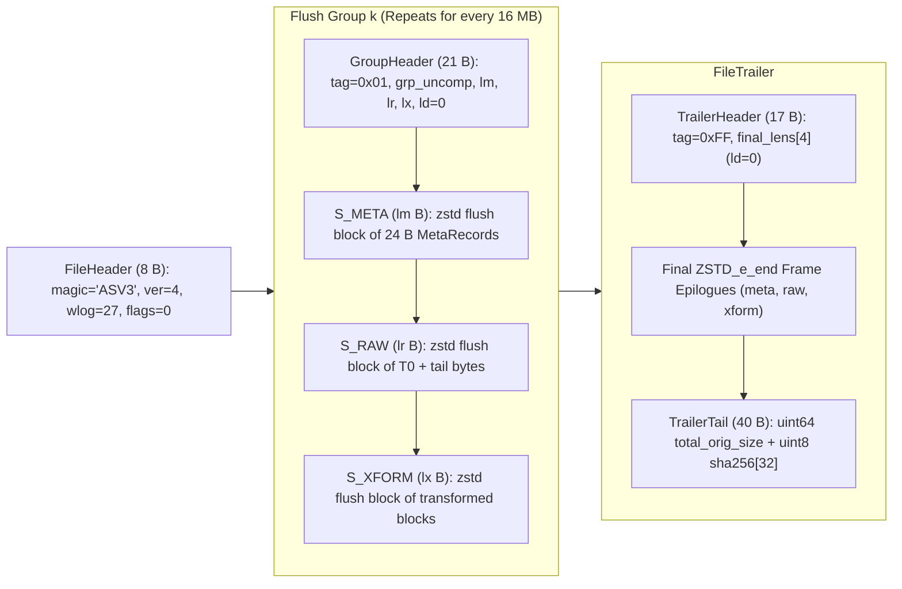
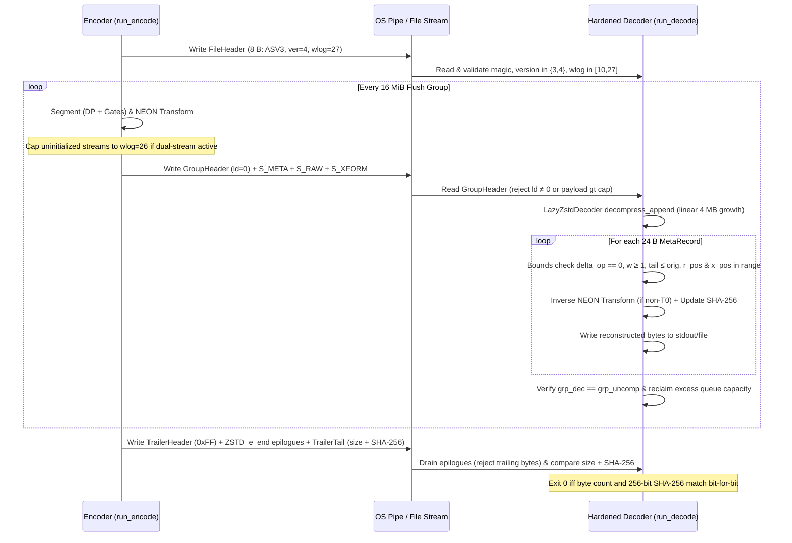
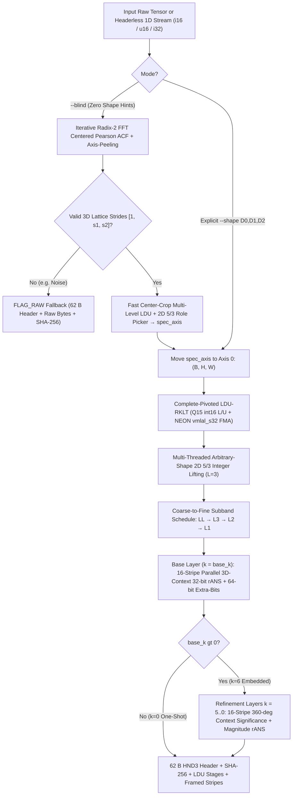
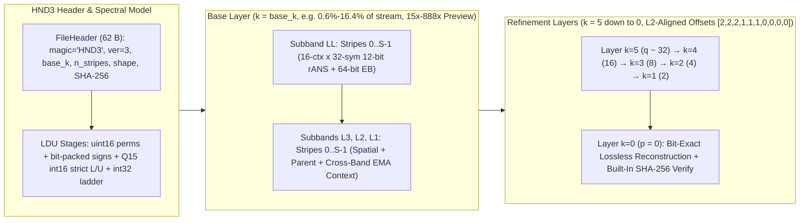
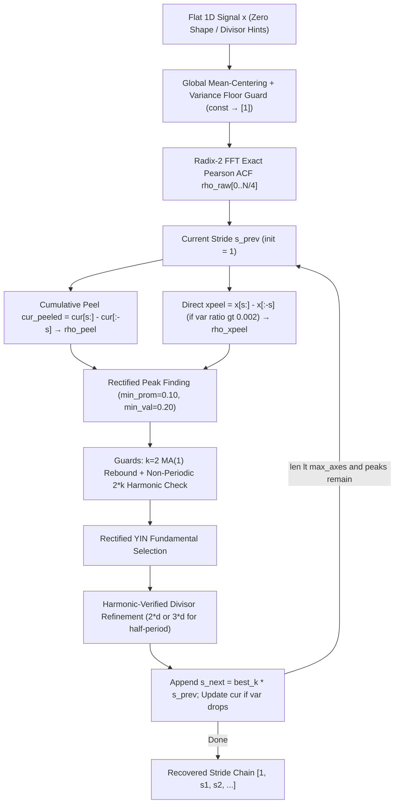

# ASV4 Architecture (`ARCHITECTURE.md`)

**ASV4 (v4.1)** is a single-pass, pipe-safe, schema-free streaming compressor written in C++20 with ARM64 NEON SIMD intrinsics and persistent `libzstd 1.5.5` streaming contexts ([`v3/cpp/asv3.cpp`](v3/cpp/asv3.cpp)). It discovers hidden binary structure online—without upfront schemas, file extensions, or backward seeks—rearranges structured spans using fast bijective transforms, coalesces transformed and raw spans into separate persistent `zstd` streams, and falls back to raw `zstd --long=27` (`T0`) with `≤ +0.0028%` overhead whenever transforming does not win.

---

## 1. End-to-End Single-Pass Streaming Pipeline

Input is processed in `16 MB` flush groups (`flush_group_bytes`) with zero backward seeks. Any partial record trailing a transformed region at a flush-group boundary is carried forward in a tiny `carry` buffer (at most `unit_stride - 1` bytes) so adjacent flush groups remain anchored to the record grid without phase drift.

---

## 2. Coupled Stage 1 & 2: Selector, Fast-Confirm & Safety Gates

Segmentation and transform selection are tightly coupled inside `segment_buffer_dp` to eliminate winner's-curse flapping, phase drift, and adversarial binary regressions (`adv_binaries.bin` stays locked at `Regs = 1, +0.002%`).

```mermaid
flowchart LR
    BUF["16 MiB Flush Group (256 x 64 KiB Slots)"] --> FC{"Stationary Fast-Confirm?"}

    FC -->|"Non-T0: consec ≥ 2, D_JS lt 0.12, i mod 8 ≠ 0"| FAST2["Fast-Confirm: Score {T0, active} (0.50x work)"]
    FC -->|"T0: consec ≥ 3, D_JS lt 0.04, i mod 4 ≠ 0"| FAST1["Fast-Confirm: Score {T0} only (0.25x work)"]
    FC -->|"Full Sweep / D_JS Spike / Mismatch"| FULL["Full Two-Tier Probe (16 KB Base + 64 KB Wide)"]

    FAST2 -->|"Active Still Wins"| DP["1D Viterbi DP (p_switch=48 KB, JS-Modulated)"]
    FAST2 -->|"Regime Changed"| FULL
    FAST1 --> DP

    subgraph Probe["Two-Tier Scorer (Per-Plane zstd -1 for w in 2..8)"]
        FULL --> H0_OUT{"Incompressible? (H0 gt 7.95 & z1 ≥ 99.5%)"}
        H0_OUT -->|"Yes"| T0_FAST["Return T0 Immediately"]
        H0_OUT -->|"No"| LAG["NEON Exact-Match Autocorrelation M(L) → Peaks (L1, L2)"]
        LAG --> MM["Miller-Madow H0 Pre-Filter + Pin {2, 4, 8} + L1"]
        MM --> TIER1["Tier 1: T1(w) Per-Plane zstd -1 + 2% Harmonic Tie-Break"]
        TIER1 --> T2_GATE{"Best T1 ≤ 0.98 * T0?"}
        T2_GATE -->|"No"| PICK["Select Best (Gain Gate ≤ 0.96 * T0)"]
        T2_GATE -->|"Yes"| TIER2["Tier 2 on Top-2 Widths: T2_XOR, T2_ELEM, T2_NIBROT (w=2,4,8), T2_BIT (w=4,8)"]
        TIER2 --> PICK
    end

    T0_FAST --> DP
    PICK --> DP

    DP --> GATES["Region Verification Gates"]

    subgraph Safety["Three-Layer Anti-Regression Guard"]
        GATES --> LDM["Gear Rolling-Hash LDM Guard vs S_RAW History (reject if overlap ≥ 15%)"]
        LDM --> Z3["2 x 256 KB Per-Plane zstd -3 Check (combined ≤ 0.94 & each ≤ z0 + 2048 B)"]
        Z3 --> FLOOR["Net Savings Floor: ≥ 256 KB (or ≥ 128 KB warm-numeric if S_XFORM active)"]
    end

    FLOOR -->|"Pass"| ACC["Accept Transformed Region"]
    FLOOR -->|"Reject"| REJ["Demote Region to T0 (S_RAW)"]
```

### Key Guardrails
- **Miller-Madow $H_0$ Pre-Filter + Pinned Word Widths `{2, 4, 8}`**: Prevents finite-sample entropy bias where wider candidate multiples (`16, 32, 64`) artificially appear lower-entropy than true fundamental widths (`BF16/FP16`, `FP32/INT32`, `FP64/INT64`).
- **Per-Plane `zstd -1` / `zstd -3` Scoring (`w ∈ [2, 8]`)**: Scores each byte plane independently (subtracting 12 B frame header per extra plane) so a 16 KB probe models the independent 128 KB zstd Huffman blocks of a 4 MB streaming block instead of averaging skewed exponent lanes with uniform mantissa lanes.
- **Gear Rolling-Hash LDM Duplication Guard (`TrailingRawIndex`)**: Maintains a 32,768-anchor shift-invariant ring buffer (~256 KB RAM) indexed **only over bytes actually routed to `S_RAW`**. Prevents splitting duplicated Mach-O/ELF tables or VM snapshot pages out of `S_RAW` where `zstd --long=27` already deduplicates them.
- **Stationary Fast-Confirm Path**: Holds average Scoring Work Multiplier to **`0.89×`** (max **`2.06×`**, well inside the `≤ 3.0×` budget) across all 16 datasets.

---

## 3. `T2_NIBROT`: Why a 4-Bit Nibble Rotation Beats OpenZL & ZipNN on Neural Weights

`T2_NIBROT` (`tid = 6`, `h = 0` LE `+1`, `h = 1` BE `−1`) applies a bijective cyclic 4-bit nibble shift across each `w`-byte word fused directly into ARM64 NEON `vld2q_u8`/`vld4q_u8` + `vsliq_n_u8` + `vst1q_u8` (zero scratch buffer, >5 GB/s).

### Information-Theoretic & Systems Mechanism
1. **Captures Exponent-Mantissa Mutual Information ($I(E_{4..0}; M_{\text{top}})$)**: In Gaussian neural weights ($\mathcal{N}(0, 0.02)$), the steep density decay across each exponent octave creates real coupling ($I(E_{4..0}; M_{6..4}) \approx +0.0523\text{ bits/bf16}$), while top exponent bits are virtually constant ($H(E_{7..5}) \approx 0$). Isolating `[E7..E0]` and `[M6..M0, S]` into separate lanes (as ZipNN and OpenZL `BFloat16Deconstruct` do) discards this coupling (`10.517 bits/bf16` theoretical byte-plane limit). `T2_NIBROT(2, h=0)` packs `[E4..E0 | M6..M4]` into a single byte's Huffman table (`5.465 b`) and `[M3..M0 | S, E7..E5]` into the other (`5.000 b`), reaching **`10.465 bits/bf16`**—beating ZipNN's theoretical byte-plane limit. On FP32 (`w = 4`), `T2_NIBROT(4, h=0)` similarly drops total byte-plane $H_0$ from `26.646` (`T1(4)`) to **`26.464 b/f32`** (`−0.182 b/f32`).
2. **Eliminates Greedy `zstd -3` LZ77 False Matches**: Plain `T1` leaves a skewed ~10-symbol exponent lane (`H0 ≈ 2.68`) where `zstd -3` wastes bits emitting accidental 4-byte matches. Raising minimum plane entropy above `5.0 bits/byte` (~160 symbols) eliminates false matches so `zstd -3` stays in pure Huffman mode at **99.95% of Shannon entropy** and **`927–1,252 MB/s`** single-core decode.
3. **Monotonic L19 Level Cap**: When `c_xform` initializes on a high-entropy `T2_NIBROT` group (`zstd -3` ratio `> 60%` of raw on the first 256 KB), `c_xform.cap_level_before_init(3)` prevents `ZSTD_btultra2` from chasing noisy long-range matches (`+6.38 MB` regression in `v4.0`), guaranteeing `L19 ≤ L3` across all 16 datasets.

---

## 4. Interleaved Flush-Group Wire Format (`ASV3` Container, `VERSION = 4`)

Zero backward seeks during encode and a single forward cursor during decode enable arbitrary Unix piping (`cat in | asv3 c | asv3 d`). `run_decode` transparently accepts both `VERSION = 3` and `VERSION = 4`.

### 24-Byte `MetaRecord` Layout (Packed Little-Endian)
| Offset | Size | Field | Description |
|---:|---:|---|---|
| 0 | 4 B | `orig_len` | Uncompressed bytes represented by this block (`xlen + tail_len`) |
| 4 | 1 B | `transform_id` | `0=T0`, `1=T1`, `2=T2_ELEM`, `3=T2_XOR`, `4=T2_BIT`, `5=T3_2D` (v3 decode compat), `6=T2_NIBROT` |
| 5 | 1 B | `delta_op` | Must be `0` (`DELTA_NONE`; Stage 3 permanently cut per Kill Gate 1B) |
| 6 | 2 B | `w` | Element / record stride width (`≥ 1`) |
| 8 | 2 B | `h` | Secondary parameter (`T2_NIBROT`: `0=LE +1`, `1=BE −1`; `T3_2D`: row width) |
| 10 | 2 B | `phase` | Grid phase offset (`0` under Region-Anchored emission) |
| 12 | 4 B | `tail_len` | Trailing raw bytes (`< unit_stride`) stored in `S_RAW` at region end |
| 16 | 8 B | `parent_rel_offset` | Reserved (`0`) |

---

## 5. Pipe-Safe Streaming Handshake & Hardened Decode (`run_decode`)

Every `MetaRecord` and stream length is bounds-checked before dereferencing (verified 10/10 clean rejections on crafted OOB/corrupt streams under `-fsanitize=undefined` on ARM64), and dual-stream zstd window memory is strictly $O(1)$ bounded (`128 MiB` single-stream `S_RAW`; `128 MiB` simultaneous dual-stream `64+64 MiB`; `192 MiB` ceiling for sequential dual-stream `128+64 MiB`). Total OS process RSS—which additionally includes 16 MiB I/O flush-group staging, decompression frame buffers, and allocator overhead—peaks at `286.8 MiB` decode / `312.9 MiB` encode on `target_mixed_structured.bin`.

---

## 6. HND3: Reversible 3D Hyperspectral Tensor Architecture (Phases 0–3)

Alongside ASV4's 1D/record streaming engine, **HND3 (`phase3-v3.2`, [`cpp/hnd3.cpp`](cpp/hnd3.cpp))** is a zero-dependency C++20 reversible 3D tensor codec (wire-compatible with [`phase3_codec.py`](phase3_codec.py), with bit-exact ARM64 NEON ↔ `-DHND3_FORCE_SCALAR` parity and variable-width escape coding supporting full-range `int32` inputs up to `|v| < 2^62`). It was developed across `Indian Pines`, `Salinas`, and `Pavia University`, and validated out-of-sample on a `132.84 MB` 224-band NASA AVIRIS scene plus non-hyperspectral 3D microscopy and MRI controls.

### 6.1 End-to-End HND3 Pipeline (Explicit & Native C++20 Blind Track A)

### 6.2 Complete-Pivoted `LDU`-RKLT, Rounding-Noise Audit, & 16-Stripe 7-Layer Embedded Layout

Complete-pivoted LU ($P\,\mathrm{diag}(s_0)\,U_{\text{KLT}}\,Q = L\,\mathrm{diag}(s_d)\,D_{\text{ladder}}\,U$) bounds all off-diagonal triangular entries to $|L_{ij}|, |U_{ij}| \le 1$ (stored losslessly in Q15 `int16`) and factors $D$ via a greedy log-balanced Daubechies-Sweldens 3-rounding diagonal ladder (no Givens fallback branch is required up to `224×224`). Unlike Phase 0's row-pivoted SERM (whose Schur-complement multipliers exploded $> 10^4$ beyond $M = 8$), complete pivoting keeps cumulative diagonal multipliers bounded to $\max|c_k|, \max|1/c_k| \in [1.42, 2.32]$ across all four real cubes—holding empirical integer-lifting rounding noise against the exact same `float64` KLT matrix to `RMS = 0.97–1.35` (`Var = 0.94–1.81`) and exact discrete zero-order entropy delta $\Delta H_{\text{disc}}$ to `+0.013`–`+0.055 b/s` on Indian Pines/Salinas/PaviaU (`+0.341 b/s` on AVIRIS and `+0.899 b/s` on a `60 dB` synthetic stress test where sub-integer/unit tail-PC noise exposes the irreducible $O(1)$-LSB lifting floor; full table in [`PHASE3_REPORT.md`](PHASE3_REPORT.md) §3). Partitioning each subband into `n_stripes = min(B, 16)` independent band stripes unlocks multi-core parallelism while letting each energy tier (`PC1..PC12` vs. noise floor `PC190..PC204`) train its own compact 12-bit rANS frequency table.

### 6.3 Native C++20 Blind Track A Stride-Lattice Discovery (`recover_strides_cpp`)

---

## 7. Evolutionary History (Falsification Record)

| Version / Tag | Milestone | Outcome |
|---|---|---|
| **v1 (`ftcc/`)** | Energy clumping + forest of trees Python/Numba prototype | Superseded by v3 strict streaming/worst-case spec |
| **v3 Phase 0 & 1A** | Coupled Stage 1 & 2 (`codec.py`) + `ASV3` container | **PASS** — 100% SHA-256, pipe-safe, `≤ +0.002%` worst-case tax |
| **v3 Phase 1B** | Stage 3 bounded delta forest (`stage3_forest.py`) | **CUT PERMANENTLY** — regressed `+11.80%` on snapshots, `+3.03%` on binaries |
| **v3.0 (`asv3_v3.0.cpp`)** | C++20 NEON port, UBSan bounds checks, fast-confirm, tiled `T2_BIT`, portable SHA-256 | **RELEASED** — `−7.05%` GPT-2, `−15.45%` Hubble FITS, `≤ +0.0028%` tax, `0.83×` Work Mult |
| **v4.0** | `T2_NIBROT` (`w=4,8`) NEON, per-plane `zstd -1/-3` scoring, combined-gain gate | Surpassed OpenZL `le32` on GPT-2 (`394.91 MB`, `1,285 MB/s` dec), `−16.86%` Hubble FITS |
| **`v4.1` (`asv3.cpp`)** | `T2_NIBROT(2)` NEON for BF16, monotonic L19 cap, `T3_2D` encoder retirement | **RELEASED** — Beats OpenZL, Blosc2 & ZipNN on GPT-2 FP32 (`394.91 MB`) & SmolLM2 BF16 (`170.44 MB`), `16/16` monotonic `L19 ≤ L3`, `0.89×` Work Mult |
| **`phase0-v2.2`** | Hyperspectral N-D falsification harness, exact Blue Book CCSDS-123 (`P=3/15`), real Rice coder, 14-test suite | **PASS** — Killed folded spatial KLT (`0A`), passed `R6` (`0B`), passed 48/48 blind stride recovery (`0D`) |
| **`phase1-v1.0`** | Gate 1A (`R6` = 91–97% variance heteroscedasticity), complete-pivoted `LDU`-RKLT, 3D-context 32-bit rANS, $L_2$-weighted Track B (`.hnd1`) | **PASS** — Beats Blue Book CCSDS-123 on real cubes (`6.427 / 4.714 / 6.441 b/s`), `99.4×` @ `59.8 dB` on Salinas |
| **`phase2-v2.0`** | Unified 7-layer quality-embedded `.hnd2` + zero-dependency C++20 NEON engine (`./hnd2`) | **PASS** — `53–60 dB` base preview from single lossless file, `92–135 MB/s` dec, UBSan + Py↔C++ verified |
| **`phase3-v3.0`** | 16-stripe parallel rANS + true NEON `vmlal_s32` FMA + 64-bit EB + native C++20 `--blind` FFT (`./hnd3`) | **CURRENT** — 7-layer embedded beats one-shot & float KLT (`4.628 b/s` Salinas `+9.1%` vs CCSDS-123, `6.354 b/s` PaviaU `+7.1%`), up to `220 MB/s` lossless / `565 MB/s` preview dec, UBSan + Py↔C++ verified |
