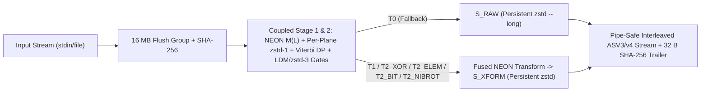

# ASV4 — Blind, Schema-Free Adaptive Stride-Transposition Streaming Compressor

**ASV4 (v4.1)** is a single-pass, pipe-safe, schema-free lossless compressor written in C++20 with ARM64 NEON SIMD intrinsics and native `libzstd 1.5.5`. Without knowing file formats, headers, or data types upfront, ASV4 discovers binary structure online, applies fused SIMD bijective transforms (including nibble-rotated byte-plane transposition `T2_NIBROT`), coalesces transformed and raw spans into lazy persistent `zstd` streams, and falls back transparently to raw `zstd --long=27` on unstructured or adversarial data.

- **Beats dedicated & supervised baselines blindly on real LLM weights**:
  - **OpenAI GPT-2 FP32 (`real_gpt2_f32.safetensors`, 522.7 MB)**: **`394.91 MB`** (**−10.38%** vs. `zstd -19 --long=27`, **−24.45%** vs. raw) at **211 MB/s** encode and **1,252 MB/s** decode on one ARM64 core — beating verified lossless **ZipNN 0.5.4 `float32` (`397.59 MB`)**, **OpenZL `le32` (`398.43 MB`)**, **Blosc2 (`401.61 MB`)**, **OpenZL `Float32Deconstruct` (`402.50 MB` aligned / `432.17 MB` raw)**, and **OpenZL `struct4+TransposeSplit` (`404.12 MB`)**.
  - **SmolLM2-135M BF16 (`real_smollm2_bf16.safetensors`, 256.6 MB)**: **`170.44 MB`** (**−15.09%** vs. `zstd -3 --long=27`, **−33.58%** vs. raw) at **208 MB/s** encode and **927–936 MB/s** decode — beating verified lossless **ZipNN 0.5.4 `bfloat16` (`171.10 MB`)**, **Blosc2 (`177.25 MB`)**, **OpenZL `BFloat16Deconstruct` (`178.68 MB`)**, and **OpenZL `le16` (`183.00 MB`)**.
- **Real scientific astronomy rasters (`real_hubble_eagle_f32.fits`, NASA/ESA Hubble WFPC2 `>f4`)**: **`15.28 MB`** (**−16.86%** vs. `zstd -19 --long=27`, within `0.14 MB` of supervised OpenZL `15.14 MB`) at **146 MB/s** encode and **680 MB/s** decode.
- **Zero-regression safety floor**: Worst-case overhead across all 5 negative & adversarial controls (1 GB `enwik9`, source `.tar`, 1,834 concatenated ARM64 Mach-O binaries, compressed media, CSPRNG random) is **`+0.0021%` (L3) / `+0.0028%` (L19)** — over 50× below the `0.15%` cap.
- **Strictly monotonic, bounded, and hardened**: `L19 ≤ L3` on **16/16** datasets, **`32/32` streaming SHA-256 PASS**, **`0.89×` avg / `2.06×` max** Scoring Work Multiplier (`≤ 3.0×` budget), **`680–1,414 MB/s`** single-core decode, **`O(1)`** bounded window memory (`≤ 192 MB` combined dual-stream ceiling), UBSan-verified bounds checks, and portable FIPS 180-4 SHA-256 fallback for Linux/x86-64.

---

## How It Works



See **[`ARCHITECTURE.md`](ARCHITECTURE.md)** for full Mermaid diagrams of the two-tier scorer, `T2_NIBROT` bit-lane information theory ($I(E_{4..0}; M_{6..4}) \approx +0.0523\text{ bits/bf16}$), interleaved wire format, and bounds-checked streaming decoder.

---

## Benchmark Results (16 Datasets / 4.95 GiB, Single-Threaded ARM64)

### Head-to-Head on Real Public AI Weights & Astronomy Data
*(All external baselines verified bit-exact lossless round-trip; aligned `.safetensors` baselines include exact header bytes. Note that ZipNN optimizes for multi-threaded model-loading throughput on aligned tensors, whereas ASV4 is a general-purpose, single-threaded, schema-free streaming compressor requiring no `.safetensors` parser.)*

| Real Public Dataset | Orig (MB) | `zstd -3` / `-19` (`libzstd 1.5.5` C API) | `Blosc2` (`zstd7`) | `OpenZL 0.3.0` *(Verified Round-Trip)* | `ZipNN 0.5.4` *(Aligned, Verified)* | **Blind `ASV4 v4.1` (L3 / L19)** |
|---|---:|---:|---:|---:|---:|---:|
| `real_gpt2_f32.safetensors` | 522.7 | 440.52 / 440.63 | 401.61 (`−8.86%`) | 398.43 (`le32`, `−9.58%`) / 402.50 (`f32Decon` aligned) / 404.12 (`tr4`) / 432.17 (`f32Decon` raw) | 397.59 (`float32`, `−9.77%`) | **394.91 (`−10.35%`) / 394.91 (`−10.38%`)** |
| `real_smollm2_bf16.safetensors` | 256.6 | 200.74 / 200.67 | 177.25 (`−11.67%`) | 178.68 (`bf16Decon`, `−10.96%`) / 183.00 (`le16`, `−8.81%`) | 171.10 (`bfloat16`, `−14.74%`) | **170.44 (`−15.09%`) / 170.44 (`−15.06%`)** |
| `real_hubble_eagle_f32.fits` | 29.5 | 18.40 / 18.38 | — | **15.14** (`le32`/`be32`, `−17.66%`) | — | **15.33 (`−16.66%`) / 15.28 (`−16.86%`)** |
| `real_mixed_public.bin` | 283.9 | 99.66 / 87.42 | 131.51 | 97.18 (`serial`) | — | **94.28 (`−5.40%`) / 82.25 (`−5.92%`)** |
| `real_nyc_taxi_struct104.bin` | 256.0 | 53.66 / **36.89** | 64.37 | 51.38 (`serial`) / 63.93 (`struct104+T`) | — | **53.66 (`+0.001%`) / 36.89 (`+0.002%`)** |
| `real_nyc_taxi_columnar.arrow` | 803.1 | 107.72 / **87.83** | 148.84 | 112.47 (`serial`) | — | **107.72 (`+0.001%`) / 87.83 (`+0.002%`)** |

### Full 16-Dataset Same-Binary Table ([`v3/final_refresh_results_v4.1.csv`](v3/final_refresh_results_v4.1.csv))

| Dataset | Orig MB | L3 vs `B2_capi` | L19 vs `B3a_capi` | Enc L3 (MB/s) | Dec L3 / L19 (MB/s) | Dec L3 RSS (MB) | Regs | Work Mult | SHA-256 |
|---|---:|---:|---:|---:|---:|---:|---:|---:|---|
| `real_gpt2_f32.safetensors` | 522.7 | **−10.354%** | **−10.375%** | 211.0 | 1251.5 / 1240.9 | 154.3 | 2 | 0.95× | PASS |
| `real_smollm2_bf16.safetensors` | 256.6 | **−15.094%** | **−15.063%** | 208.3 | 926.6 / 935.6 | 150.8 | 3 | 0.85× | PASS |
| `real_hubble_eagle_f32.fits` | 29.5 | **−16.658%** | **−16.860%** | 146.3 | 680.4 / 636.3 | 89.6 | 3 | 1.04× | PASS |
| `real_mixed_public.bin` | 283.9 | **−5.401%** | **−5.920%** | 115.8 | 848.9 / 942.3 | 225.1 | 9 | 0.93× | PASS |
| `real_nyc_taxi_struct104.bin` | 256.0 | +0.001% | +0.002% | 112.5 | 715.0 / 985.7 | 194.6 | 1 | 0.62× | PASS |
| `real_nyc_taxi_columnar.arrow` | 803.1 | +0.001% | +0.002% | 118.5 | 986.4 / 1231.3 | 193.7 | 1 | 1.18× | PASS |
| `target_numeric_f32.bin` | 256.0 | **−41.758%** | **−33.479%** | 157.8 | 847.1 / 732.5 | 202.2 | 1 | 1.29× | PASS |
| `target_struct64.bin` | 256.0 | **−68.167%** | **−54.072%** | 179.7 | 695.7 / 691.5 | 198.1 | 1 | 0.78× | PASS |
| `target_sqlite.db` | 311.3 | **−9.566%** | **−6.554%** | 89.8 | 737.3 / 632.8 | 286.0 | 2 | 1.00× | PASS |
| `target_mixed_structured.bin` | 256.0 | **−42.944%** | **−32.186%** | 132.6 | 825.1 / 718.9 | 286.8 | 8 | 1.08× | PASS |
| `target_snapshots.bin` | 256.0 | +0.001% | +0.001% | 343.0 | 1364.3 / 1414.0 | 207.0 | 1 | 0.25× | PASS |
| `neg_enwik9.xml` (1 GB) | 953.7 | **+0.001%** | **+0.001%** | 108.4 | 779.0 / 781.0 | 196.8 | 1 | 0.73× | PASS |
| `neg_source_tar.tar` | 273.2 | **+0.002%** | **+0.002%** | 111.3 | 1040.9 / 1051.1 | 193.6 | 1 | 0.97× | PASS |
| `adv_binaries.bin` | 160.0 | **+0.002%** | **+0.003%** | 81.8 | 1136.5 / 1123.4 | 193.9 | 1 | 2.06× | PASS |
| `adv_compressed_media.tar` | 126.0 | **+0.000%** | **+0.000%** | 299.1 | 1332.3 / 1281.9 | 211.0 | 1 | 0.33× | PASS |
| `adv_random.bin` | 64.0 | **+0.000%** | **+0.000%** | 374.4 | 1128.7 / 1112.0 | 142.8 | 1 | 0.25× | PASS |

---

## Quickstart

### Build (macOS Apple Silicon or Linux x86-64/ARM64)
Requires a C++20 compiler (`clang++` or `g++`) and `libzstd` (`>= 1.5`).

```bash
# macOS (adjust -I/-L if using Homebrew /opt/homebrew or conda /opt/anaconda3)
clang++ -O3 -std=c++20 -mcpu=native -Wall -Wextra \
  -I/opt/anaconda3/include -L/opt/anaconda3/lib -Wl,-rpath,/opt/anaconda3/lib \
  v3/cpp/asv3.cpp -lzstd -o v3/cpp/asv3

# Linux (uses built-in portable FIPS 180-4 SHA-256 automatically)
g++ -O3 -std=c++20 -march=native -Wall -Wextra \
  v3/cpp/asv3.cpp -lzstd -o v3/cpp/asv3
```

### Usage (Files or Unix Pipes)
```bash
# Compress & decompress files (automatic streaming SHA-256 verification on decode)
./v3/cpp/asv3 c --level 3 model.safetensors model.asv4
./v3/cpp/asv3 d model.asv4 model.restored

# Pipe-safe streaming (zero backward seeks)
cat model.safetensors | ./v3/cpp/asv3 c --level 3 | ./v3/cpp/asv3 d > /dev/null

# Archival preset (--level 19, guaranteed <= --level 3) with JSON stats & trace
./v3/cpp/asv3 c --level 19 --stats stats.json --trace input.bin output.asv4
```

### Reproduce Benchmarks
```bash
# Build exact in-process libzstd C API baseline harness
clang++ -O3 -std=c++20 -I/opt/anaconda3/include -L/opt/anaconda3/lib -Wl,-rpath,/opt/anaconda3/lib \
  v3/cpp/zstd_capi_bench.cpp -lzstd -o v3/cpp/zstd_capi_bench

# Generate synthetic/local 10-file corpus (requires enwik9 download inside build_corpus.py)
python3 v3/build_corpus.py

# Run full 16-dataset same-binary L3 & L19 benchmark
python3 v3/bench_final_refresh.py
```

---

## Repository Map

| Path | Description |
|---|---|
| [`ARCHITECTURE.md`](ARCHITECTURE.md) | System architecture & Mermaid diagrams (pipeline, DP selector, `T2_NIBROT`, wire format, decoder handshake) |
| [`v3/cpp/asv3.cpp`](v3/cpp/asv3.cpp) | **Production C++20 NEON ASV4 v4.1 streaming encoder & hardened decoder** |
| [`v3/cpp/asv3_v3.0.cpp`](v3/cpp/asv3_v3.0.cpp) | Frozen `v3.0` C++20 NEON reference snapshot |
| [`v3/cpp/zstd_capi_bench.cpp`](v3/cpp/zstd_capi_bench.cpp) | Exact in-process single-threaded `libzstd` C API baseline harness (`B2_capi` / `B3a_capi`) |
| [`v3/REPORT_V4.md`](v3/REPORT_V4.md) | Complete **ASV4 v4.1** technical report (16 datasets, OpenZL/Blosc2/ZipNN comparisons, theoretical analysis) |
| [`v3/REPORT_V3.md`](v3/REPORT_V3.md) | Staged Phase 0 → 1A → 1B → 2 build report & Kill Gate 1B falsification record |
| [`v3/AUDIT_V3.md`](v3/AUDIT_V3.md) | Forensic audit artifacts (corpus provenance, C-API baselines, divergence traces, OpenZL chunk-32 fix) |
| [`v3/final_refresh_results_v4.1.csv`](v3/final_refresh_results_v4.1.csv) | Canonical 16-dataset `v4.1` L3 & L19 CSV (plus archived `v3.0` and `v4.0` CSVs) |
| [`v3/codec.py`](v3/codec.py), [`v3/transforms.py`](v3/transforms.py) | Phase 1A Python/Numba reference implementation (wire-compatible with `v3`) |
| [`v3/stage3_forest.py`](v3/stage3_forest.py) | Phase 1B Stage 3 delta-forest ablation (falsified & cut per Kill Gate 1B) |
| [`v3/bench_final_refresh.py`](v3/bench_final_refresh.py) | Same-binary 16-dataset L3 & L19 wall-clock / Peak RSS benchmark driver |
| [`ftcc/`](ftcc/) | Initial v1 forest-tree energy-clumping prototype (superseded by v3/v4) |
